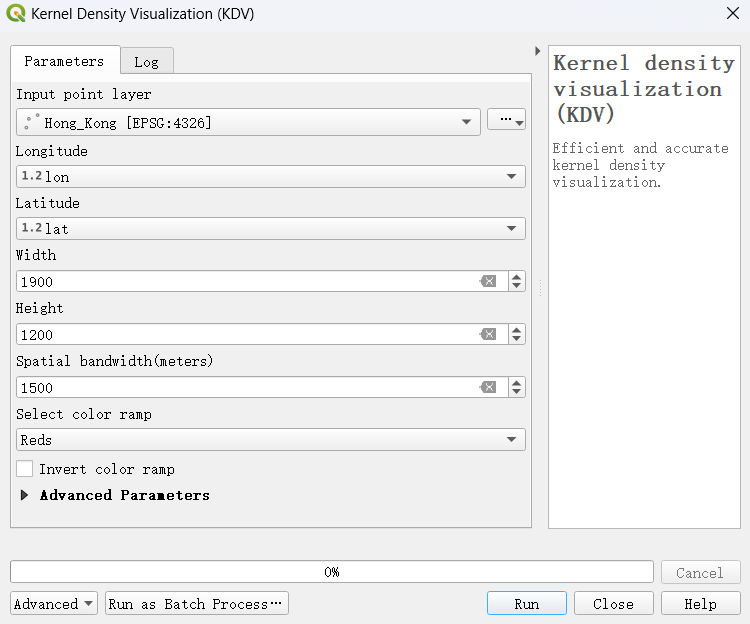
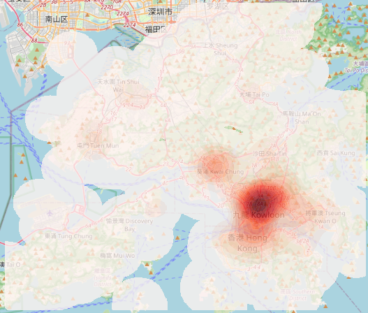
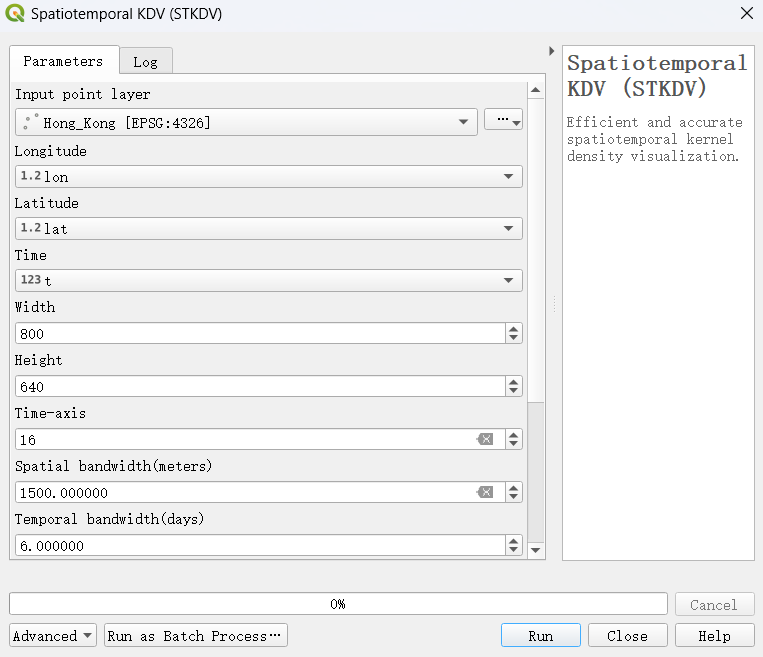
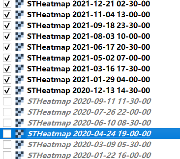
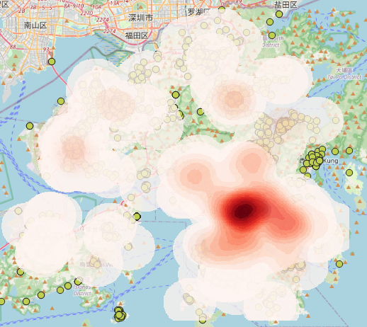
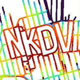
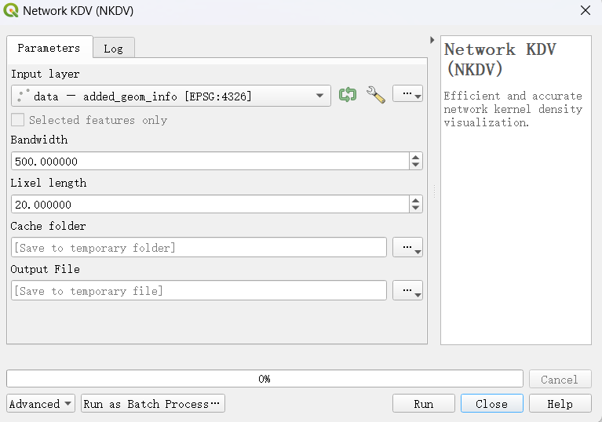
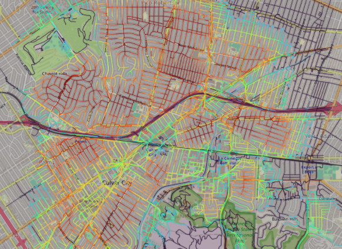

# Fast Density Analysis

A Powerful QGIS plug-in for Large-scale Geospatial Analytics

Unlock the power of large-scale geospatial analysis - with our QGIS plugin, quickly generate high-resolution kernel density visualizations, supporting advanced analysis tasks such as bandwidth-tuning and spatiotemporal analysis. No matter what size your dataset are, our plugin delivers efficient and accurate results. Download now and start a new chapter in your geospatial analysis journey!

Powered by:

- [LibKDV](https://github.com/libkdv/libkdv) - The fastest KDV library in the world.
- [PyNKDV](https://github.com/edisonchan2013928/PyNKDV) - The fastest NKDV library in the world.

## Installation

1. Open QGIS
2. Go to **Plugins** → **Manage and Install Plugins**
3. Search for "**Fast Density Analysis**"
4. Click **Install Plugin**

## Kernel Density Visualization(KDV)

Efficient and accurate kernel density visualization.

### Parameters

| Parameter                  | Description              | Default |
| -------------------------- | ------------------------ | ------- |
| Input point layer          | Point layer              | -       |
| Spatial bandwidth (meters) | Spatial kernel bandwidth | 1000    |
| Row/Column pixels          | Output raster resolution | 800x640 |

### Result heatmap:

---

## Spatiotemporal KDV (STKDV)

Efficient and accurate spatiotemporal kernel density visualization. Analyzes how density patterns change over time.

### Parameters

| Parameter | Description | Default |
|-----------|-------------|---------|
| Input point layer | Point layer with time attribute | - |
| Time field | Field containing timestamp/datetime | - |
| Spatial bandwidth (meters) | Spatial kernel bandwidth | 1000 |
| Temporal bandwidth (days) | Temporal kernel bandwidth | 6 |
| Number of timestamps | How many time slices to generate | 8 |
| Row/Column pixels | Output raster resolution | 400x320 |

### Result Spatiotemporal heatmaps:

Generates multiple raster layers, one for each timestamp:

---

## Network KDV (NKDV)

Efficient and accurate network-constrained kernel density visualization. Computes density along road networks instead of Euclidean space.

### Parameters

| Parameter | Description | Default |
|-----------|-------------|---------|
| Input point layer | Point layer to analyze | - |
| Cache folder | Folder for temporary files | - |
| Bandwidth (meters) | Network distance bandwidth | 500 |
| Lixel size (meters) | Road segment length for analysis | 20 |
| Kernel type | Gaussian, Triangular, Epanechnikov, Quartic | Epanechnikov |

### Features

- **Automatic road network download**: Downloads OpenStreetMap road network for the study area
- **Network caching**: Caches downloaded networks to speed up subsequent analyses
- **Network simplification**: Automatically simplifies complex road networks

### Result Network heatmaps:

---

## Network Temporal KDV (NTKDV)

Efficient and accurate network temporal kernel density visualization. Combines network-constrained analysis with temporal dynamics.

### Parameters

| Parameter | Description | Default |
|-----------|-------------|---------|
| Input point layer | Point layer with time attribute | - |
| Time field | Field containing timestamp/datetime | - |
| Cache folder | Folder for temporary files | - |
| Spatial bandwidth (meters) | Network distance bandwidth | 500 |
| Temporal bandwidth (days) | Temporal kernel bandwidth | 6 |
| Lixel size (meters) | Road segment length for analysis | 20 |
| Number of timestamps | How many time slices to generate | 8 |
| Kernel type | Epanechnikov, Quartic | Epanechnikov |

### Features

- **Automatic time range detection**: Automatically determines start/end time from data
- **Network caching**: Reuses cached road networks from NKDV
- **Multiple output layers**: Generates one vector layer per timestamp

### Time Field Format

The time field should contain valid datetime values. Supported formats:
- `YYYY-MM-DD HH:MM:SS`
- `YYYY-MM-DD`
- Unix timestamp (seconds since 1970-01-01)

## Troubleshooting

### Windows OS: Plugin Uninstall Failed

On Windows OS, if you encounter "Failed to remove the directory" error when uninstalling the plugin, this is due to Windows file locking on the C++ libraries (DLLs) used by this plugin.

**Solution:**
Restart QGIS and try uninstalling again - the second attempt usually succeeds.

## Project Members:

[Prof. (Edison) Tsz Nam Chan](https://www.comp.hkbu.edu.hk/~edisonchan/), Hong Kong Baptist University

Mr. Bojian Zhu, Xidian University (now in Hong Kong Baptist University)

Mr. Rui Zang, Hong Kong Baptist University

[Prof. (Ryan) Leong Hou U](https://www.fst.um.edu.mo/personal/ryanlhu/), University of Macau

[Prof. Jianliang Xu](https://www.comp.hkbu.edu.hk/~xujl/), Hong Kong Baptist University

## Publications:

1. Tsz Nam Chan, Rui Zang, Pak Lon Ip, Leong Hou U, Jianliang Xu. PyNKDV: An Efficient Network Kernel Density Visualization Library for Geospatial Analytic Systems. Proceedings of ACM Conference on Management of Data (SIGMOD), 2023.
2. Tsz Nam Chan, Leong Hou U, Byron Choi, Jianliang Xu, Reynold Cheng. Large-scale Geospatial Analytics: Problems, Challenges, and Opportunities. Proceedings of ACM Conference on Management of Data (SIGMOD), 2023.
3. Tsz Nam Chan, Leong Hou U, Byron Choi, Jianliang Xu, Reynold Cheng. Kernel Density Visualization for Big Geospatial Data: Algorithms and Applications. IEEE International Conference on Mobile Data Management (MDM), 2023.
4. Tsz Nam Chan, Leong Hou U, Byron Choi, Jianliang Xu. SLAM: Efficient Sweep Line Algorithms for Kernel Density Visualization. Proceedings of ACM Conference on Management of Data (SIGMOD), 2022.
5. Tsz Nam Chan, Pak Lon Ip, Kaiyan Zhao, Leong Hou U, Byron Choi, Jianliang Xu. LIBKDV: A Versatile Kernel Density Visualization Library for Geospatial Analytics. Proceedings of the VLDB Endowment (PVLDB), 2022.
6. Tsz Nam Chan, Pak Lon Ip, Leong Hou U, Byron Choi, Jianliang Xu. SWS: A Complexity-Optimized Solution for Spatial-Temporal Kernel Density Visualization. Proceedings of the VLDB Endowment (PVLDB), 2022.
7. Tsz Nam Chan, Pak Lon Ip, Leong Hou U, Byron Choi, Jianliang Xu. SAFE: A Share-and-Aggregate Bandwidth Exploration Framework for Kernel Density Visualization. Proceedings of the VLDB Endowment (PVLDB), 2022.
8. Tsz Nam Chan, Zhe Li, Leong Hou U, Jianliang Xu, Reynold Cheng. Fast Augmentation Algorithms for Network Kernel Density Visualization. Proceedings of the VLDB Endowment (PVLDB), 2021.
9. Tsz Nam Chan, Pak Lon Ip, Leong Hou U, Weng Hou Tong, Shivansh Mittal, Ye Li, Reynold Cheng. KDV-Explorer: A Near Real-Time Kernel Density Visualization System for Spatial Analysis. Proceedings of the VLDB Endowment (PVLDB), 2021.
10. Tsz Nam Chan, Reynold Cheng, Man Lung Yiu. QUAD: Quadratic-Bound-based Kernel Density Visualization. Proceedings of ACM Conference on Management of Data (SIGMOD), 2020.
11. Tsz Nam Chan, Leong Hou U, Reynold Cheng, Man Lung Yiu, Shivansh Mittal. Efficient Algorithms for Kernel Aggregation Queries. IEEE Transactions on Knowledge and Data Engineering (TKDE).
12. Tsz Nam Chan, Man Lung Yiu, Leong Hou U. KARL: Fast Kernel Aggregation Queries. IEEE International Conference on Data Engineering (ICDE), 2019.
